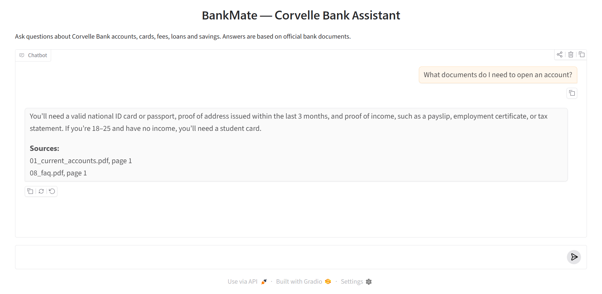

# BankMate — RAG Banking Assistant

BankMate is a Retrieval-Augmented Generation (RAG) assistant designed to answer retail banking customer questions on accounts, cards, fees, loans and savings.

Instead of relying on the general knowledge of a language model, BankMate retrieves the relevant passages from the bank's official documents and generates answers grounded exclusively in them. Each response cites its source document and page, and the assistant explicitly declines to answer when the information is not available, which reduces hallucinations in a domain where accuracy matters.

The system is exposed through a FastAPI REST endpoint and a Gradio chat interface, and is deployed on Render with continuous deployment from GitHub.

🔗 **Live demo:** https://bankmate.onrender.com · **API:** https://bankmate.onrender.com/docs



## Tech Stack
Python · LangChain · Chroma · OpenAI · FastAPI · Gradio · uv · Render

## How It Works
PDFs → `PDFPlumberLoader` (keeps tables readable) → chunks → embeddings → Chroma → top-k retrieval → LLM → answer

## Run Locally
```bash
git clone https://github.com/wiame-ghannan/BankMate.git
cd BankMate
uv sync
echo "OPENAI_API_KEY=your_key" > .env
uv run uvicorn main:app --reload
```
Chat: http://127.0.0.1:8000 · API: http://127.0.0.1:8000/docs

## Example
```json
POST /ask
{ "question": "What is the annual fee of the Gold card?" }
→ { "answer": "The annual fee for the Gold card is 250 MAD." }
```

> The documents describe *Corvelle Bank*, a demo bank created for this project.

**Author:** Wiame Ghannan — [@wiame-ghannan](https://github.com/wiame-ghannan)